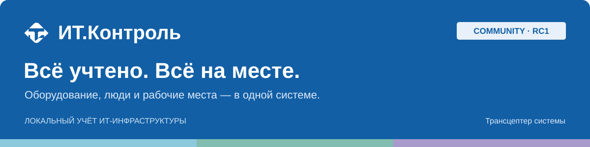
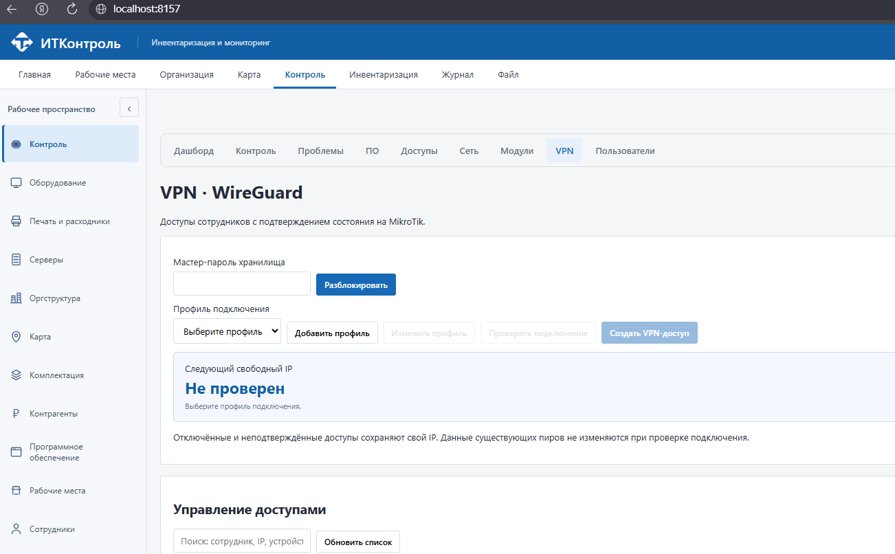

  

# ИТ.Контроль Community RC1

**Локальная система учёта оборудования и инвентаризации ИТ-инфраструктуры.**

Оборудование, сотрудники, рабочие места, программное обеспечение и заявки — в одной системе на твоём сервере. Community помогает навести порядок в небольшой инфраструктуре и сохранить информацию в собственном контуре.

| Скачать | Посмотреть | Разобраться |
| --- | --- | --- |
| **[Community RC1 для Windows + Docker](https://github.com/TranscepterSystemy/it-control-community/releases/download/RC1/ITControl_Community_RC1.zip)** | **[Сайт и демо](https://it-controller.ru/)** | **[Руководство пользователя](https://github.com/TranscepterSystemy/it-control-community/blob/main/docs/ITControl_User_Manual_v2_RC1.pdf)** |

> **RC1 — кандидат в релиз, а не Stable.** Предназначен для публичного тестирования. Бесплатная редакция поддерживает ручной учёт; автоматический сбор и мониторинг относятся к отдельным коммерческим модулям.

### Меньше искать. Больше понимать.

| Что у нас есть? | Где и у кого? | Что нужно учесть? |
| --- | --- | --- |
| Компьютеры, серверы, принтеры, NAS и комплектующие. | Площадки, отделы, сотрудники и рабочие места. | ПО, инвентаризации, HelpDesk, расходные материалы и ИТ-расходы. |

## Скачать Community RC1

**[Скачать IT.Control Community RC1](https://github.com/TranscepterSystemy/it-control-community/releases/download/RC1/ITControl_Community_RC1.zip)**

Архив содержит актуальную сборку Community RC1 для запуска через `START.cmd`. Скачивание доступно всем без авторизации. Текущая сборка включает бесплатный модуль учёта ИТ-расходов и унифицированные схематичные пиктограммы оборудования в стиле интерфейса IT.Control.

[SHA-256 архива](https://github.com/TranscepterSystemy/it-control-community/releases/download/RC1/ITControl_Community_RC1.zip.sha256) · `f679fcafa740f0b3ffe3c085ffa370e2b8aba21e575aa00a4c7883302bb6d322`

Для установки используй архив **ITControl_Community_RC1.zip** по ссылке выше.

## Что входит в Community RC1

- организации, компании, площадки и подразделения;
- сотрудники и рабочие места;
- учёт оборудования;
- серверы, серверные помещения и стойки;
- печатающая техника и расходные материалы;
- комплектация оборудования;
- ручной учёт программного обеспечения;
- учёт ИТ-расходов: покупки и услуги, суммы, получатели/активы, поставщики, документы и Excel-экспорт;
- импорт и экспорт Excel;
- инвентаризация;
- HelpDesk;
- NAS / Storage;
- карта размещения;
- пользователи и роли;
- журнал действий;
- обновления и административные инструменты Community.

Community предназначена прежде всего для **ручного учёта и инвентаризации**. Автоматический сбор данных и постоянный мониторинг относятся к коммерческим модулям.

## Ограничения Community

Community бесплатна без ограничения по сроку использования, но имеет ограничения по масштабу инфраструктуры.

| Объект | Лимит Community |
|---|---:|
| Организации | 1 |
| Компании | 1 |
| Площадки | до 3 |
| Сотрудники | до 25 |
| Рабочие места | до 25 |
| Оборудование | до 25 единиц суммарно |
| Пользователи IT.Control | до 3 учётных записей |

Серверы, NAS, компьютеры, ноутбуки, принтеры и другие IT-активы входят в **общий лимит оборудования**.

При достижении лимита существующие данные не удаляются и не блокируются. Их можно просматривать, редактировать и экспортировать. Ограничивается только создание новых объектов сверх лимита.

## Что не входит в Community

Следующие возможности относятся к коммерческим редакциям и модулям IT.Control:

- Windows Agent;
- автоматический сбор характеристик компьютеров;
- автоматическая инвентаризация установленного ПО;
- Windows Collector;
- MikroTik Collector;
- Monitoring / Telemetry;
- heartbeat и online/offline-контроль;
- история автоматической телеметрии;
- централизованные действия через агенты;
- WireGuard automation;
- Deploy и массовое развёртывание ПО;
- AD Control / AD Deploy;
- другие модули автоматизации и централизованного управления.

Ограничения Community контролируются серверной частью приложения, а не только интерфейсом.

<strong>Настоящий интерфейс ИТКонтроля: пример дополнительного VPN-модуля</strong>

**VPN / WireGuard не входит в Community RC1.** Ниже показан реальный рабочий экран расширенной версии, а не функция бесплатного архива. Готовность и условия выпуска дополнительных модулей объявляются отдельно.

[Открыть сайт и примеры интерфейса](https://it-controller.ru/#demo)

## Установка RC1

Текущий RC1 подготовлен для **Windows + Docker Desktop**.

### Требования

- Windows с поддерживаемой версией Docker Desktop в режиме Linux containers;
- установленный и запущенный Docker;
- доступ к интернету при первой сборке контейнеров.

### Запуск

1. Скачайте архив Community RC1.
2. Распакуйте его в отдельную папку.
3. Запустите `START.cmd`.
4. Дождитесь окончания запуска.
5. IT.Control автоматически откроется в браузере. При первом запуске создай пароль Главного администратора, при обновлении войди с существующим паролем.

Пользователю не требуется вручную создавать базу данных, настраивать PostgreSQL или выполнять Docker-команды.

При первом запуске IT.Control:

- создаёт отдельный Docker-контур Community RC;
- создаёт отдельную базу PostgreSQL;
- генерирует пароль базы данных;
- автоматически выбирает свободный web-порт;
- сохраняет локальные настройки для последующих запусков.

RC-контур устанавливается отдельно от уже существующих экземпляров IT.Control и не должен затрагивать их базы данных.

## Обновление RC1

Перед обновлением сделай резервную копию базы и папки установки. Останови приложение через `STOP.cmd`. Замени программные файлы файлами из нового архива, сохранив `.env`, `updates`, пользовательские `app/static/map-backgrounds` и существующий том PostgreSQL. Запусти `START.cmd`.

Исправления текущего кандидата публикуются как **2.0.0-RC1**. Каждая проверенная сборка имеет свою контрольную сумму SHA-256.

## Диагностика

Если приложение не смогло запуститься, `START.cmd` формирует файл:

`STARTUP_ERROR.log`

Он содержит состояние Docker Compose, журнал web-контейнера и журнал PostgreSQL. При сообщении об ошибке этот файл следует приложить к обращению.

## Документация

- [Руководство пользователя и администратора — IT.Control RC1](docs/ITControl_User_Manual_v2_RC1.pdf)

## Проверки перед публикацией

Проверены приложение на Windows и Linux, подготовка запуска через `cmd.exe` и Windows PowerShell 5.1, вход и выход, права доступа, обновление с сохранением пароля и данных, Chromium и Docker с PostgreSQL. Запуск на Windows подтверждён автором проекта.

[Условия бесплатного использования](LICENSE.txt)

## Данные и приватность

IT.Control разворачивается локально. Инвентаризационные данные, структура организации и служебная информация хранятся в локальной базе установленного экземпляра.

## О проекте

**Разработано: [Трансцептер системы](https://github.com/TranscepterSystemy)**  
© 2026 Трансцептер системы

IT.Control развивается как модульная платформа: бесплатная Community-редакция даёт базовый учёт и инвентаризацию, а автоматизация, мониторинг и централизованное управление подключаются отдельными коммерческими возможностями.

---

**IT.Control Community RC1** — первый публичный кандидат новой релизной линии.

